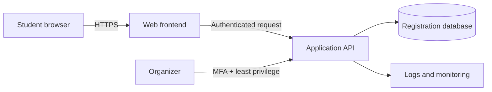

# Week 1 Lab: Cloud concepts and safe setup

[← Practical labs](README.md) · [← Week 1 guide](../weeks/week-01.md)

## Mission
Design a small cloud architecture before creating resources. Understand what the provider manages, what your team manages, and where cost and security risks appear.

**Time:** 60–90 minutes  
**Difficulty:** Beginner core, intermediate stretch  
**Cost:** KES 0 / no cloud account required

## What you will produce
1. A one-page architecture sketch for a student event-registration app.
2. A service-model comparison.
3. A shared-responsibility checklist.
4. A safe-account and cost checklist.

## Scenario
A student club needs a simple event-registration system. Students view events and submit a registration form. Organizers can view registrations. Assume the first version has a web frontend, an API and a database. Use synthetic data only.

## Part A — Learn the cloud vocabulary

Write a one-sentence explanation in your own words for each term:

| Term | Prompt |
|---|---|
| Cloud computing | What is being provided over a network? |
| Region | What does a geographic deployment area represent? |
| Zone | Why can a region contain multiple zones? |
| IaaS | Which infrastructure components do you manage? |
| PaaS | What does the provider manage for you? |
| SaaS | What does the customer mainly configure and use? |
| IAM | Who can do what, on which resource? |
| Shared responsibility | Why is security not entirely the provider's job? |

Do not memorize definitions without an example. For instance, compare renting a virtual machine with deploying application code to a managed runtime.

## Part B — Compare service models

For the event-registration scenario, complete this table:

| Option | What you manage | What provider manages | Main trade-off |
|---|---|---|---|
| Virtual machine (IaaS) | | | |
| Managed app platform (PaaS) | | | |
| Hosted event product (SaaS) | | | |

Discuss which option is fastest to launch and which gives the team the most operational control. There is no universally correct answer; explain your assumptions.

## Part C — Draw the architecture

Create a diagram using paper, diagrams.net, Excalidraw or Mermaid. Include:
- Student browser
- HTTPS connection
- Frontend
- API/backend
- Database
- Organizer/admin access
- Identity and access control boundary
- Logs/monitoring
- A trust boundary between public users and private data

Example starting point (edit it; do not submit it unchanged):

Add arrows showing data flow. Mark which components are publicly reachable and which must remain private. Explain where authentication and authorization happen.

## Part D — Shared responsibility

For each task, decide whether it is primarily the provider's responsibility, the customer's responsibility, or shared. Explain one answer that could change depending on the service model.

- Physical data-centre security
- Guest operating-system patching on a self-managed VM
- Application input validation
- IAM role assignment
- Database backup configuration
- Protecting account credentials
- Provider infrastructure availability

## Part E — Account and cost safety

You do not need to create a cloud project for this lab. If a facilitator asks you to inspect a provider console, do so only after confirming the account and billing arrangement.

Checklist:
- [ ] I know which account/project I am using.
- [ ] I have enabled MFA on the account where available.
- [ ] I understand who is responsible for billing.
- [ ] I checked current pricing and free-tier eligibility.
- [ ] I know that a budget notification is not a hard spending cap.
- [ ] I will not create always-on or expensive resources for this exercise.
- [ ] I will never share credentials or commit key files.

**Important:** Do not enter payment details or enable billing just to complete this lab. Ask the Track Lead if account access is unclear.

## Checkpoint questions
1. Give an example of IaaS, PaaS and SaaS.
2. Why are regions and zones not interchangeable?
3. If a provider secures the physical data centre, who patches your VM?
4. Why is a budget alert not a spending limit?
5. Which component in your diagram contains the most sensitive data, and how is it protected?

## Intermediate stretch
Compare two possible designs:
- A single VM running frontend, API and database.
- A managed frontend/API with a managed database.

Compare operational effort, availability, scaling, security boundaries and cost drivers. State the assumptions behind your recommendation.

## Submission
Create `week-01-evidence.md` in your learning log containing:
- Architecture diagram or image link.
- Completed service-model table.
- Your shared-responsibility answers.
- Answers to the five checkpoint questions.
- One trade-off or risk you discovered.

Do not include account IDs, billing screenshots, email addresses or credentials.

## Troubleshooting
- **Not sure how to draw a diagram:** use labelled boxes and arrows on paper; clarity matters more than the tool.
- **Unsure who manages a component:** state the service model first. Responsibility changes between IaaS, PaaS and SaaS.
- **Cloud console asks for billing:** stop. This lab does not require billing. Use the no-cloud path and ask the facilitator.

## Cleanup
No cloud resources should have been created. If you independently created a project or resources, verify ownership and billing with the account owner before deleting anything.
